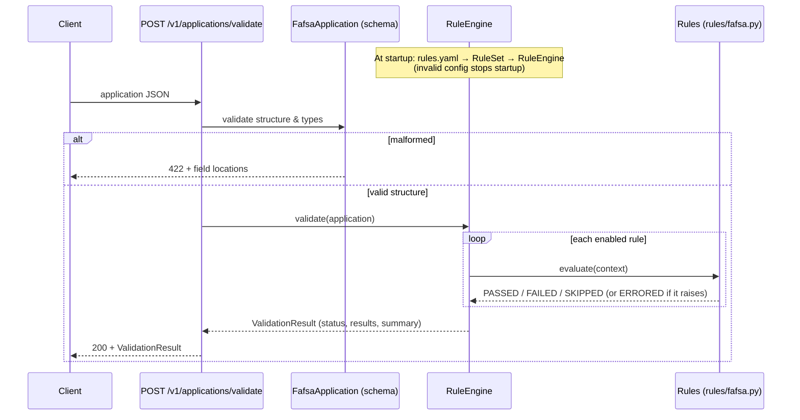

# FAFSA Edit Rule Processor

## What is this?

The `fafsa-edit-rule-processor` is a REST service that accepts [FAFSA](https://studentaid.gov/h/apply-for-aid/fafsa) data and applies a series of validation rules ("edits") to determine applicant validity. All rules are applied to every application, and the response reports each rule's outcome, what's wrong, and which fields to fix.

Design decisions and trade-offs are in [DECISIONS.md](DECISIONS.md).

## Configuration

### Dependencies

- python 3.14
- uv
- make

### Environment variables

| Variable | Default | Description |
|---|---|---|
| `FAFSA_RULES_PATH` | `config/rules.yaml` | Rule configuration file |
| `FAFSA_LOG_LEVEL` | `INFO` | Log level |

### Rules

Rule configuration lives in [`config/rules.yaml`](config/rules.yaml). Each rule's severity (`ERROR`, `WARNING`, `INFO`), message, params, and `enabled` flag can be changed without a code change; bump `version` with every change. Changes take effect on restart. An invalid file (unknown rule, missing param, bad severity) stops the service from starting.

## Running

```sh
# create/update the virtual environment
make sync

make run
```

## Testing

```sh
# run unit tests
make test

# ruff + ty
make lint

make format
```

## API

| Method | Path | Description |
|---|---|---|
| `GET` | `/healthz` | Health check |
| `GET` | `/propertiez` | Active settings and ruleset |
| `POST` | `/v1/applications/validate` | Validate an application |

### Example

```sh
curl -s -X POST http://localhost:8000/v1/applications/validate \
  -H 'Content-Type: application/json' \
  -d @tests/fixtures/invalid_application.json
```

A structurally valid application returns `200`, even when rules fail (results abbreviated):

```json
{
  "status": "INVALID",
  "rulesetVersion": "2026-27.1",
  "summary": { "total": 7, "passed": 0, "failed": 7, "skipped": 0, "errored": 0 },
  "results": [
    {
      "ruleId": "SSN_FORMAT",
      "outcome": "FAILED",
      "severity": "ERROR",
      "message": "SSN must be exactly 9 digits, with no dashes or spaces.",
      "fields": ["studentInfo.ssn"]
    },
    {
      "ruleId": "COLLEGE_WITHIN_HOUSEHOLD",
      "outcome": "FAILED",
      "severity": "ERROR",
      "message": "Number in college cannot exceed number in household.",
      "fields": ["household.numberInCollege", "household.numberInHousehold"]
    }
  ]
}
```

| `status` | Meaning |
|---|---|
| `VALID` | No `ERROR` or `WARNING` rule failed |
| `VALID_WITH_WARNINGS` | Only `WARNING` rules failed; can proceed but should be reviewed (e.g. `STATE_CODE` configured as `WARNING` and the state is `PR`) |
| `INCOMPLETE` | A rule errored, so the application couldn't be fully validated (e.g. a bug in a rule raises an exception) |
| `INVALID` | An `ERROR` rule failed; must be corrected (e.g. SSN `123-45-6789` fails `SSN_FORMAT`) |

| `outcome` | Meaning |
|---|---|
| `PASSED` | Rule applied and was satisfied |
| `FAILED` | Rule applied and was violated; see `message` and `fields` |
| `SKIPPED` | Rule doesn't apply (e.g. spouse rule for a single student) |
| `ERRORED` | Rule raised an error; its result is unknown |

`fields` lists the JSON paths of the input fields to correct.

A malformed application (missing required field, wrong type, unknown field) returns `422` with the offending field's location.

### How a request flows



## Adding a rule

1. Implement it in [`rules/fafsa.py`](src/fafsa_edit_rule_processor/rules/fafsa.py) and register it with an id (and any params it requires):
   ```python
   @registry.register("MAX_HOUSEHOLD", params=["max"])
   def max_household(ctx: RuleContext) -> Evaluation:
       if ctx.application.household.number_in_household > ctx.params["max"]:
           return Evaluation.failed("household.numberInHousehold")
       return Evaluation.passed()
   ```
2. Configure it in `config/rules.yaml`:
   ```yaml
   - rule_id: MAX_HOUSEHOLD
     severity: WARNING
     message: "Household size over {max}; please verify."
     params:
       max: 15
   ```
3. Add cases to [`tests/unit/rules/test_fafsa.py`](tests/unit/rules/test_fafsa.py).

### Staging a rule

A rule's config can ship before its code:

1. Add it to `rules.yaml` with `enabled: false`. The service starts and logs a warning that the rule has no implementation.
2. Ship the implementation.
3. Set `enabled: true`, bump `version`, and restart.

Enabling a rule before its code exists stops startup (`no implementation for rule ...`), so a rule can never be silently skipped.
